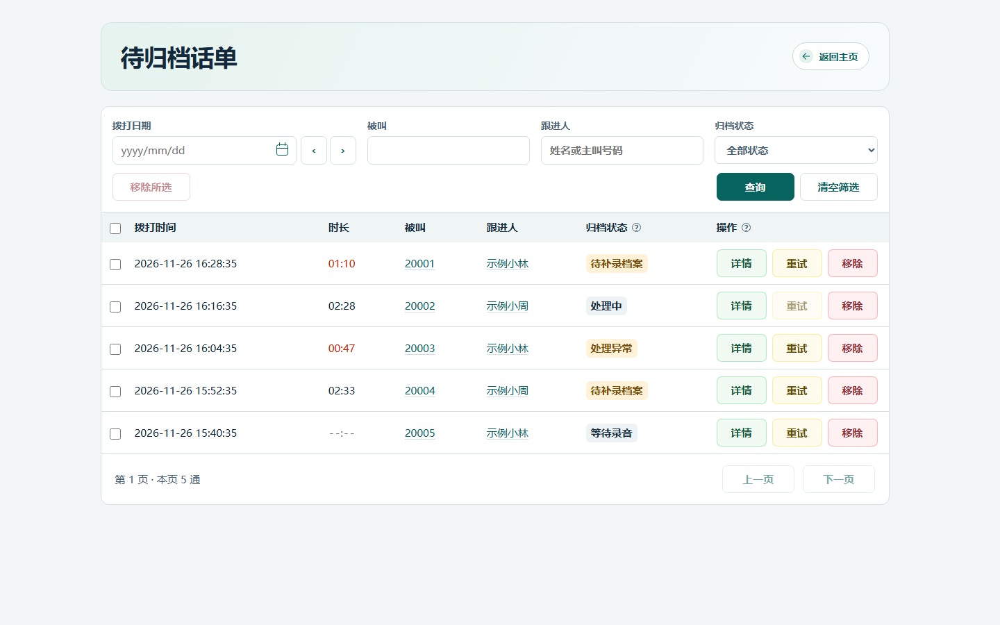
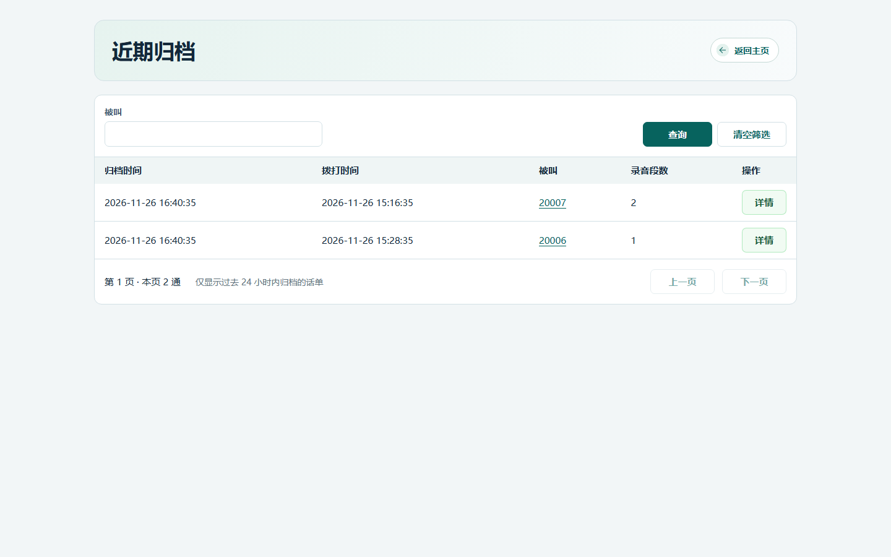

# CallArchive：通话录音转写与归档

CallArchive 是可自托管的通话录音工作台。它接收话单和录音，将录音转成文本，再把原录音和文本一起归档。网页提供待归档、近期归档、录音转写和运行日志。

转写服务可独立部署，业务系统可以直接提交录音、查进度和取结果。归档后台也使用同一个转写接口，因此可以换识别引擎，保留现有的外呼、归档和通知流程。

| 集成 | 职责 |
| --- | --- |
| 仟客 | 拉取已接通的话单，下载录音并补查尚未可用的录音 |
| 北森 | 按被叫号码查找应聘档案，将录音和转写文本作为附件归档 |
| 飞书 | 通过群自定义机器人发送待办提醒和日报 |

可组合使用上述集成，也可用本地归档、通知预览和独立转写。外呼、档案、通知和转写有独立接口，详见[模块契约](docs/module-contracts.md)。

## 页面演示

在已安装 CallArchive 的项目目录运行 `python examples/demo.py`，打开 `http://127.0.0.1:8878`，用终端显示的临时凭据登录。演示使用合成号码、话单和录音，在临时数据库中展示待归档和近期归档页面，启动时不需要外部服务。

**待归档话单**



**近期归档**



## 快速试用独立转写

需要 Python 3.10 或以上版本。以下命令适用于 Bash，在项目目录操作：

```bash
python -m venv .venv
source .venv/bin/activate
python -m pip install .
cp callarchive.example.toml callarchive.toml
token="$(python -c 'import secrets; print(secrets.token_urlsafe(32))')"
export CALLARCHIVE_IDENTITIES="{\"local\":{\"token\":\"$token\"}}"
python -m callarchive serve --config callarchive.toml
```

另一个终端在同一目录激活虚拟环境，运行 `python -m callarchive worker --config callarchive.toml`。随后用第一个终端保存的令牌访问 `http://127.0.0.1:8765/docs`，按[转写 API](docs/transcription-api.md)上传录音。默认演示引擎用于验证流程。需要实际识别时，接入 [Fun-ASR-Nano](docs/nano.md) 或命令行引擎。

## 部署和接入

- [启动、账号与定时任务](docs/configuration.md)
- [仟客、北森与飞书接入](docs/integrations.md)
- [转写 API](docs/transcription-api.md)

## 运行测试

```bash
python -m pip install -e '.[test]'
python -m unittest discover -s tests
```

## 许可证

本项目代码和文档采用 MIT 许可证。第三方依赖、模型权重和外部服务各自适用其许可证或服务条款。 [许可证全文](LICENSE)
